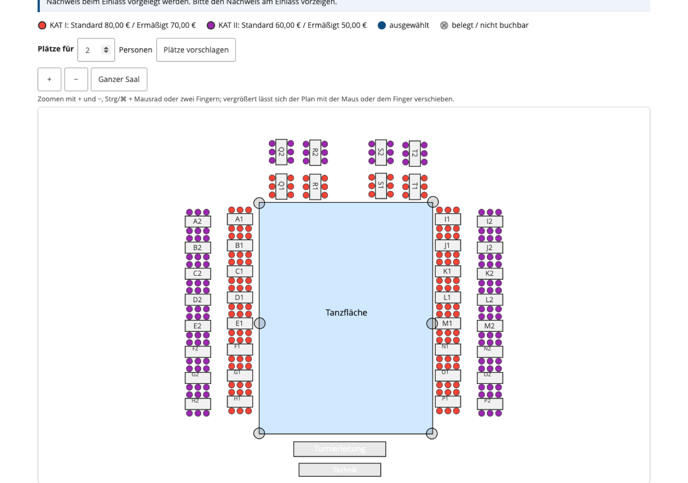
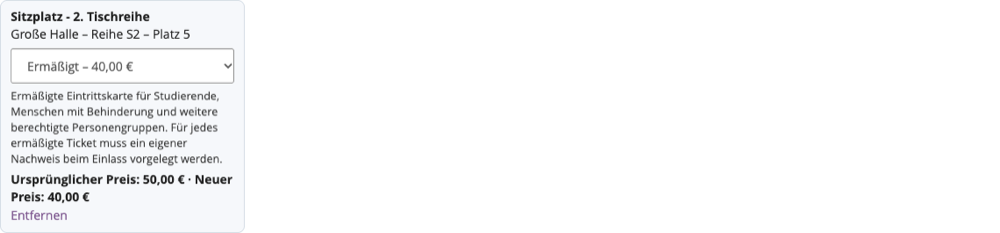
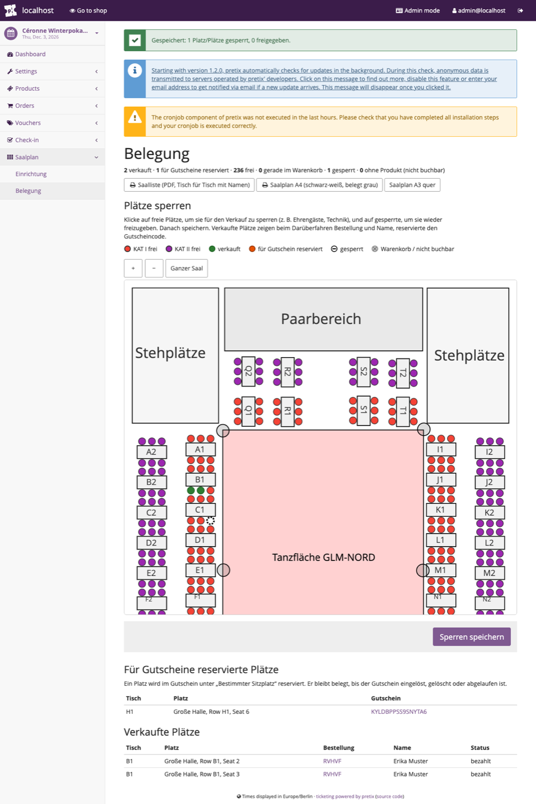
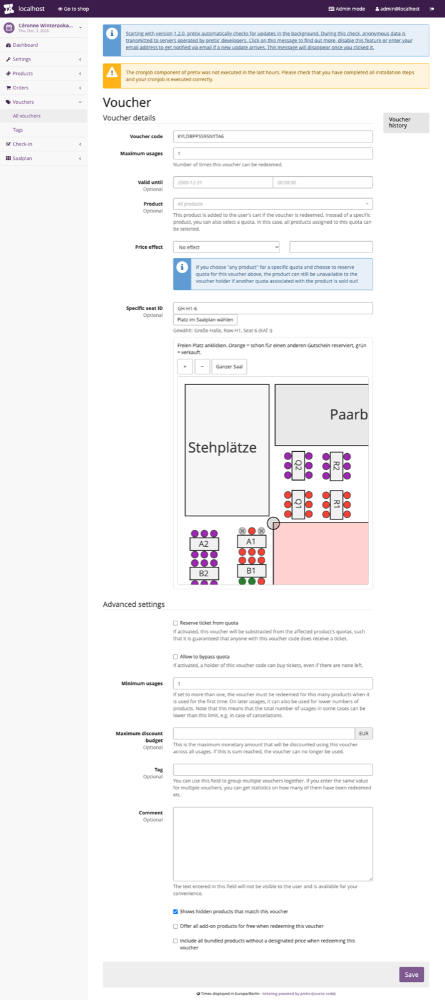
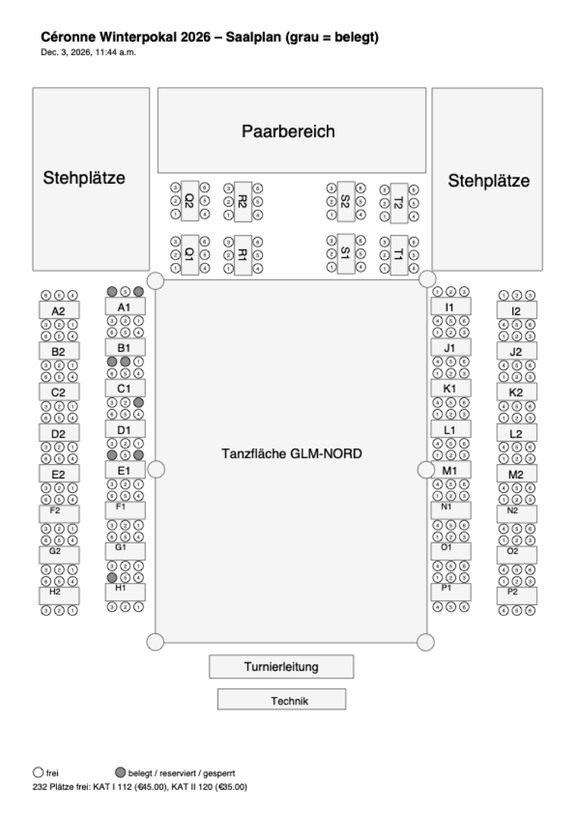

# pretix-ceronne – Saalplan mit Platzwahl

Ein pretix-Plugin, das der **Community-Version von pretix** eine vollständige Sitzplatz-Buchung gibt. Der
pretix-Kern bringt Saalpläne, Plätze, die Platzreservierung im Warenkorb und die Platzangabe auf Tickets bereits mit –
es fehlen aber die Oberflächen dafür (diese gibt es sonst nur im kostenpflichtigen pretix Hosted/Enterprise). Genau
diese Oberflächen liefert das Plugin.



## Funktionen

### Im Shop
- Saalplan als Grafik: Flächen, Beschriftungen, Tische, Plätze in der Farbe ihrer Kategorie, Legende mit Preisen
- Auswahl per **Maus**, per **Tastatur** (Tab in den Plan, Pfeiltasten zum nächsten freien Platz, Leertaste/Enter
  wählt, T wählt den ganzen Tisch) und als **Liste** zum Ankreuzen – die Liste funktioniert auch ohne JavaScript
- **Barrierefrei:** jeder Platz ist für Screenreader ein Kontrollkästchen mit Platz, Kategorie und Preis;
  geprüft mit axe-core (WCAG 2.2 AA) ohne Befund
- **Ganze Tische** per Klick auf das Tischschild
- **Plätze vorschlagen:** Anzahl Personen eingeben, das Plugin wählt passende Plätze nebeneinander
- **Varianten** je Platz, z. B. „Standard 80 € / Ermäßigt 70 €“. Die Beschreibung der Variante (z. B. wer ermäßigte
  Tickets nutzen darf) steht als Hinweis über dem Plan und beim gewählten Platz
- Gewählte Plätze erscheinen wie ein Ticket: Produkt, Platz, Ticketart, Beschreibung, Preis – mit Gutschein
  „Ursprünglicher Preis … · Neuer Preis …“

  
- **Live:** belegte Plätze werden im Hintergrund alle paar Sekunden aktualisiert, ohne die Seite neu zu laden;
  wird ein gerade gewählter Platz von jemand anderem gebucht, wird er abgewählt und es erscheint ein Hinweis
- **Ganzer Saal auf einen Blick:** Der Plan passt immer in das Fenster, ohne zu scrollen. Zoomen mit + / −,
  Strg/⌘ + Mausrad oder zwei Fingern (Trackpad, Handy); vergrößert lässt er sich per Ziehen verschieben
- **Handy:** Der ganze Saal passt in die Breite; der erste Tipp auf einen Platz zoomt heran, der zweite wählt ihn

  
- Kompatibel mit der Content Security Policy von pretix (kein Inline-Code)

### Buchungsregeln (je Veranstaltung einstellbar)
- Tische: nur einzelne Plätze / einzelne Plätze und ganze Tische / **nur ganze Tische**
- **Keine Einzellücken:** zwischen zwei belegten Plätzen bleibt kein einzelner Platz frei
- **Kein einzelner Restplatz** an einem Tisch
- Die Regeln werden im Shop sofort angezeigt **und vor der Kasse auf dem Server geprüft** – sie lassen sich nicht
  umgehen

### Im Backend
- *Veranstaltung → Saalplan → Einrichtung:* Saalplan (JSON im pretix-Saalplanformat) hochladen, Kategorien den
  Produkten zuordnen (Kategorien ohne Produkt sind sichtbar, aber nicht buchbar), Regeln festlegen
- *Saalplan → Belegung:* Plan mit verkauften Plätzen (Bestellnummer und Name beim Darüberfahren), Plätze per Klick
  **sperren**, Listen der verkauften und der für Gutscheine reservierten Plätze

  
- **Gutschein mit festem Platz:** im Gutschein-Formular „Platz im Saalplan wählen“. Der Platz ist für alle anderen
  belegt, bis der Gutschein eingelöst (dann gehört er zur Bestellung), gelöscht oder abgelaufen ist (dann ist er
  wieder frei). Beim Einlösen ist er im Shop vorausgewählt.

  
- **Ausdrucke (PDF):**
  - *Saalliste* – Tisch für Tisch mit Namen, Bestellnummer, Ticketart, Status und Kästchen zum Abhaken am Einlass;
    Varianten mit Beschreibung (z. B. Ermäßigt) sind mit „Nachweis prüfen“ markiert
  - *Saalplan* (A4 oder A3) in Schwarz-Weiß, belegte Plätze grau, plus Liste der freien Plätze je Tisch – zum
    Verkauf an der Abendkasse

   

## Voraussetzungen

- pretix **2025.1 oder neuer** (getestet mit 2026.9.0), Community-Version, selbst betrieben
- Einzelne Veranstaltungen (Veranstaltungsreihen werden nicht unterstützt)
- Ein Saalplan im pretix-JSON-Format (z. B. aus dem pretix-Saalplan-Editor exportiert). Ein „Tisch“ ist eine Reihe
  des Plans; das Tischschild wird über den gleichen Text erkannt (Reihe „A1“ ↔ Fläche mit Text „A1“)

## Installation

### Mit pip (z. B. in einer klassischen Installation)

```bash
pip install "git+https://github.com/danieljark/pretix_plugins.git#subdirectory=pretix-ceronne"
python -m pretix migrate
python -m pretix rebuild
```

### Im offiziellen Docker-Image (`pretix/standalone`)

Eigenes Image bauen:

```dockerfile
FROM pretix/standalone:stable
USER root
RUN pip3 install --no-build-isolation \
    "git+https://github.com/danieljark/pretix_plugins.git@main#subdirectory=pretix-ceronne"
USER pretixuser
RUN cd /pretix/src && make production
```

```bash
docker build -t mein-pretix:saalplan .
```

Dann im Compose-/Portainer-Stack das Image austauschen und den Container neu starten. Eine feste Version statt
`@main` (z. B. ein Commit-Hash) macht den Build reproduzierbar.

### Aktivieren

1. In der Veranstaltung *Einstellungen → Plugins → „Céronne Saalplan“* aktivieren.
2. Produkte anlegen, z. B. „Sitzplatz Kategorie I“ (gern mit Varianten wie Standard/Ermäßigt), und einem
   Kontingent zuordnen.
3. *Saalplan → Einrichtung:* Plan hochladen, Kategorien den Produkten zuordnen, Regeln wählen, speichern. Pretix legt
   dabei alle Plätze an.
4. Fertig – im Shop erscheint der Saalplan statt der Mengenauswahl für die Sitzplatz-Produkte.

Die Reservierungsdauer im Warenkorb stellt pretix selbst ein (*Einstellungen → Verkauf*, Standard 30 Minuten).

## Entwicklung

```
pretix_ceronne/
  apps.py          Plugin-Anmeldung
  signals.py       Einstieg in pretix: Shop-Plan, Navigation, Fußzeilen-Link, Prüfung vor der Kasse
  daten.py         Daten für den Plan (Plätze, Status, Kategorien, Varianten)
  regeln.py        Buchungsregeln (dieselbe Logik steckt in saalplan.js)
  views.py         Backend-Seiten, PDFs, Live-Status
  pdf.py           Saalliste und Saalplan als PDF (reportlab)
  templates/       Shop- und Backend-Vorlagen
  static/          saalplan.js (Zeichnen, Auswahl, Regeln, Live), gutschein.js (Platzwahl im Gutschein), CSS
```

Eine lokale Testinstanz lässt sich mit dem offiziellen Image und Docker Compose aufsetzen (pretix + PostgreSQL +
Redis, Plugin per `pip install -e` eingebunden). Nach Änderungen an `static/` `python -m pretix collectstatic`
ausführen und den Container neu starten – pretix merkt sich die Dateinamen beim Start.

## Lizenz

AGPL-3.0-or-later, siehe [`LICENSE`](LICENSE) und die Hinweise im [Haupt-README](../README.md#lizenz).
Copyright (C) 2026 Club Céronne im ETV Hamburg e.V.
